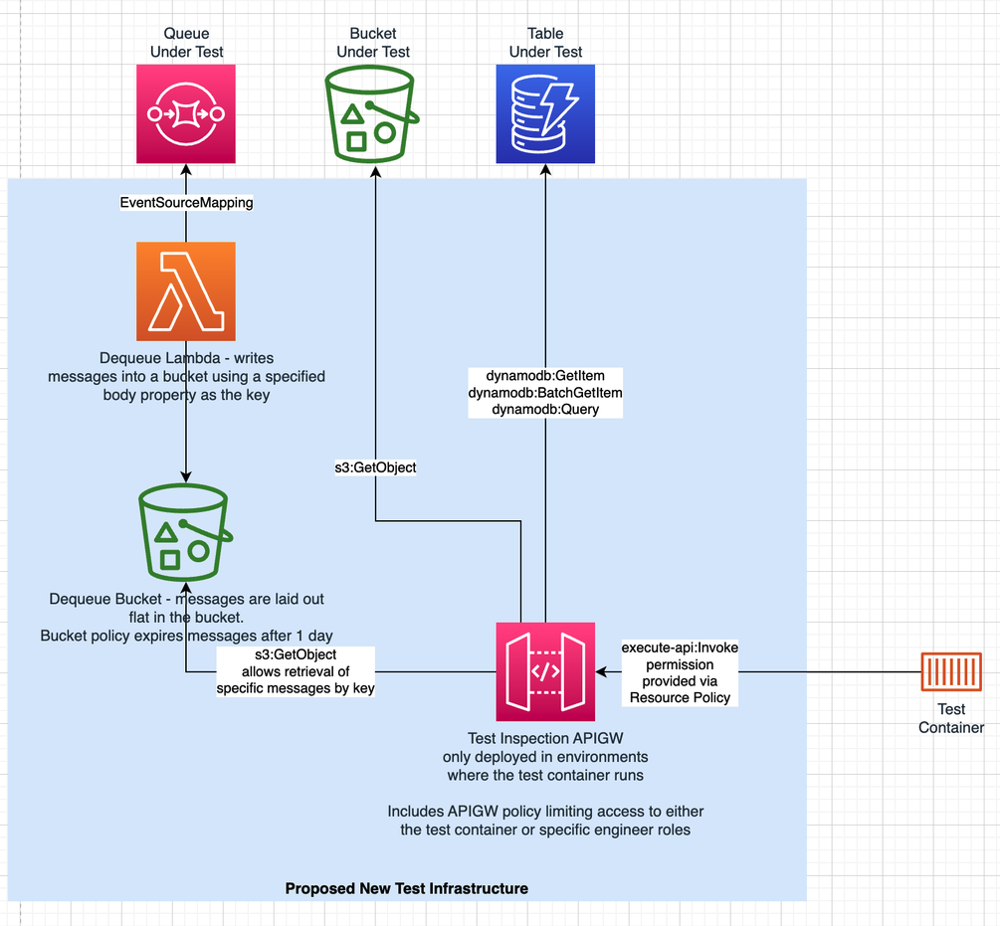

# Test Harness 

This is a test harness that listens to events from IPV Core and TxMA SQS queues and puts them in the `${AWS::StackName}-f2f-event-test-${Environment}` bucket which can then be accessed using and API.

This test harness is only to be used in dev and build environments

## How to use
1. Deploy a custom F2F stack with the changes that you'd like to test. If you would like to test against what is in dev then ignore this step
2. Update the test-harness/samconfig.toml with a stack name, and the backend stack that you'd like to use (if you don't change this the dev stack will be used)

To test SQS events:

3. Trigger the events that you are looking for 
4. Call the `/bucket/` endpoint with a prefix (either `ipv-core/` or `txma/`) to get all event objects from S3. Alternatively call the `/object/{object-key}` to get a specific event object from S3

To test DynamoDB changes:

3. Make change to DB item that you are looking for
4. Call the `/getRecord/{tableName}/{sessionId}` endpoint

## Yoti callback test UI
A browser UI that lists F2F sessions and lets you trigger the Yoti callbacks (`first_branch_visit`, `thank_you_email_requested`, `session_completion`, in that order) for a session, by starting the F2F stack's Yoti callback state machine. It is served by the `YotiCallbackTestUI` lambda through the harness API. This is designed to enable a non-Kiwi engineer to conduct an E2E F2F journey in the Staging environment.

- **URL:** `/yoti-callback-test-ui` on the test harness domain (`<stack-name>-` is prefixed to the domain in dev stacks).
- **Access:** unlike the other harness endpoints (SigV4, same AWS account only), the UI is opened in a browser, so it is restricted to approved source IPs by the API resource policy in `test-harness-spec.yaml`.
- **Dependencies on the F2F stack (`BackendStack`):** the session table (name, ARN and encryption key) and the Yoti callback state machine ARN (`<BackendStack>-YotiCallbackStateMachine-arn`). The F2F stack must be deployed with that export before the harness.
- **Environments:** dev and build only (the only environments the harness deploys to).

### Run it locally
The local server runs the same bundle the lambda does, but against real AWS resources, so you need AWS credentials (for example an SSO/profile login) for the account that holds the F2F stack.

```sh
cd test-harness/src
npm ci
export AWS_REGION=eu-west-2                   # region of the F2F stack
export SESSION_TABLE=<session-table-name>     # the F2F stack's SessionTable-name export
export STATE_MACHINE_ARN=<state-machine-arn>  # the F2F stack's YotiCallbackStateMachine-arn export
npm run ui:dev
```

Then open http://localhost:3000/yoti-callback-test-ui (set `PORT` to change the port). Local build output is written to `yotiCallbackTestUI/.build/` (gitignored).

## Architecture

